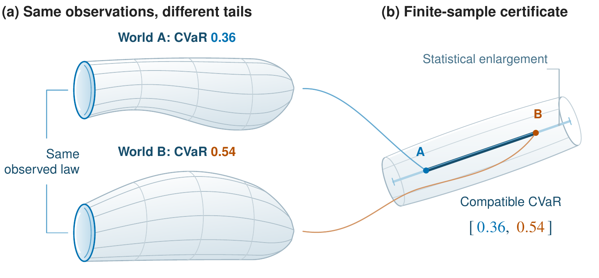

# Hidden Tails

**Certifying Tail-Risk Claims under Selective Labels**  
El Mustapha Mansouri · Institute of Science Tokyo

[Paper (PDF)](camera_ready_v3_10page/main.pdf) · [Supplement (PDF)](camera_ready_v3_10page/supplement.pdf) · [Experiment guide](docs/experiments.md) · [Data preparation](docs/data.md) · [Figure guide](docs/figures.md)



This repository accompanies *Hidden Tails: Certifying Tail-Risk Claims under Selective Labels*. It contains the manuscript, editable TikZ/PGFPlots figures, experiment implementations, saved numerical results, configurations, and provenance records.

The framework bounds population CVaR under selective labels, estimates the compatible risk interval, and uses tail identification value to allocate additional outcome observations.

For camera-ready submission, `main.pdf` is the complete single manuscript PDF, including all Appendices A–F and the NeurIPS checklist. `supplement.pdf` is a companion reading copy of the appendices. The portable ZIP provides the reproducibility materials and editable sources.

## Start here

```bash
git clone https://github.com/E-zClap/hidden-tails.git
cd hidden-tails
python scripts/verify_release.py
```

The verification uses only Python's standard library. It checks the release checksums and the saved sequential results, including all 20 recorded masking repetitions, six policies, nine rounds, and paired terminal comparisons. Raw loan records and a GPU are not needed.

| Goal | What to run | What is needed |
|---|---|---|
| Read the paper | Open [`main.pdf`](camera_ready_v3_10page/main.pdf) | PDF viewer |
| Read the companion supplement | Open [`supplement.pdf`](camera_ready_v3_10page/supplement.pdf) | PDF viewer; keep beside `main.pdf` |
| Build the supplement | `python scripts/build.py --supplement` | Python, pdfLaTeX, BibTeX |
| Package the reproducibility archive | `python scripts/package_supplement.py` | Python; unmodified release checkout |
| Compile the manuscript | `python scripts/build.py --paper` | Python, pdfLaTeX, BibTeX |
| Rebuild all nine figures and the paper | `python scripts/build.py --figures --paper` | Above, plus TikZ/PGFPlots and standalone |
| Regenerate plotting tables | Follow [the figure guide](docs/figures.md) | Python dependencies; bundled results |
| Rerun synthetic experiments | Follow [the experiment guide](docs/experiments.md) | Python; no external data |
| Rerun LendingClub experiments | Follow [data preparation](docs/data.md), then [the experiment guide](docs/experiments.md) | Accepted/rejected source files; pinned environment; CUDA for the reported configuration |

For Python experiments, use Python 3.12 and the pinned dependencies:

```bash
python -m venv .venv
# Linux/macOS:
source .venv/bin/activate
# Windows PowerShell instead:
# .venv\Scripts\Activate.ps1
python -m pip install -r requirements.txt
```

For LaTeX on Ubuntu, install `texlive-latex-extra texlive-science texlive-fonts-recommended texlive-fonts-extra texlive-plain-generic` (the figures use the `newtx` fonts). A complete MiKTeX or TeX Live installation also works. Build logs go into ignored `build/` directories. Rebuilt PDFs may have different file hashes because of timestamps and TeX versions; run the checksum check on the unmodified checkout. `python scripts/verify_release.py --results-only` checks the saved numerical records after rebuilding.

## What is included

- [`camera_ready_v3_10page/`](camera_ready_v3_10page/): the complete camera-ready manuscript with Appendices A–F and the NeurIPS checklist, a companion supplement sharing those appendices (including the five additional experimental tables), LaTeX sources, four main figures, five supplementary figures, plotting tables, and extraction scripts.
- [`experiments/`](experiments/): finite-sample simulations, population diagnostics, learning illustrations, and synthetic revelation experiments, with saved outputs.
- [`real_data_evaluation/`](real_data_evaluation/): historical LendingClub assessment, controlled masking, fixed-predictor audits, source preparation, tests, and the original results archive.
- [`camera_ready_v3_10page/revision_experiments/sequential_plugin/`](camera_ready_v3_10page/revision_experiments/sequential_plugin/): the current sequential retained plug-in experiment, tests, all 1,080 round-level results, checkpoints, and paired summaries.
- [`RELEASE_MANIFEST.json`](RELEASE_MANIFEST.json): SHA-256 checksums for the published files.

The established directory names are retained so the manuscript, extraction scripts, and experimental provenance agree. Raw borrower records, prepared cohorts, cached predictions, model binaries, private Git history, and manuscript review drafts are excluded.

The [supplement guide](docs/supplement.md) maps the revision and additional studies to their saved outputs and commands. The portable release ZIP includes both PDFs, editable sources, code, results, and all verification inputs. Appendix F distinguishes fixed reference forecasts and grid-based population diagnostics from statistical guarantees.

## Reproducibility scope

All paper figures can be rebuilt from the included plotting tables. The numerical extraction scripts can regenerate those tables from the included experimental results. Full LendingClub reruns require obtaining the source data separately; source hashes and preparation checks are documented. The reported cohort contains 390,644 applications: 53,367 mature issued loans and 337,277 rejected applications.

The original historical and masking experiments and the current sequential experiment are separate protocols. The archived `part_b_adaptive_audits.csv` belongs to the earlier sequential procedure; the current paper's sequential figures use `sequential_plugin/results/optimized/`. GPU/platform differences can affect trajectories even with fixed seeds, so cross-platform bitwise equality is not promised. The known comparison and input-identity evidence are included.

Lending intervals and fold enlargement are empirical evaluations. They do not establish the theorem's simultaneous finite-sample coverage or coverage across adaptive audit rounds. See the manuscript's assumptions and limitations, and [the experiment guide](docs/experiments.md), for the scope of each result.

GitHub Actions checks file integrity, runs the lightweight regression suites, and builds the nine figures and manuscript. It does not rerun the full GPU experiments or download LendingClub records.

## Citation and license

```bibtex
@misc{mansouri2026hiddentails,
  author = {Mansouri, El Mustapha},
  title = {Hidden Tails: Certifying Tail-Risk Claims under Selective Labels},
  year = {2026},
  howpublished = {Manuscript and reproducibility repository},
  url = {https://github.com/E-zClap/hidden-tails}
}
```

The experiment code and software documentation are available under the [MIT license](LICENSE). Manuscript text, scientific figures, third-party styles, and source datasets have separate rights; see [NOTICE.md](NOTICE.md). [CITATION.cff](CITATION.cff) provides machine-readable citation metadata. This repository does not assert a publication or acceptance status.
